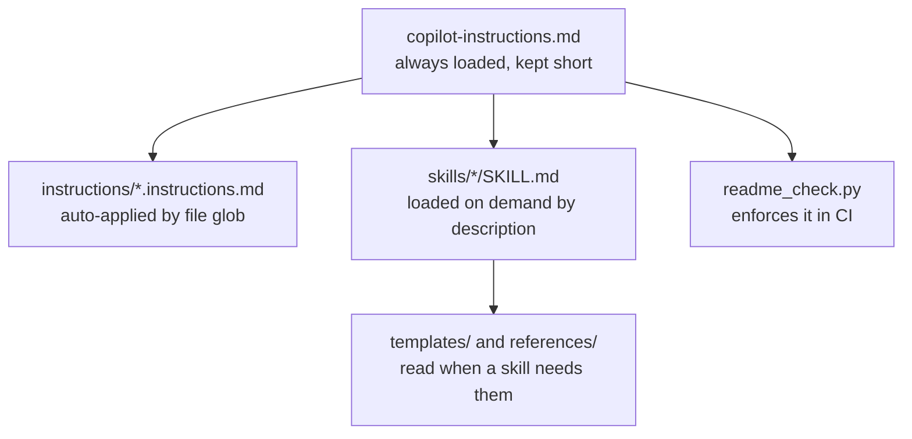

# Groundwork

A starting repo for agent-built projects. It carries the instructions, skills and templates
that get an AI coding agent to finish the job properly: not just working code, but a README
a stranger can follow from a fresh clone to a running project. Use it for anything from a
one-file Python script or a notebook to a landing page or a deployed Azure web app.

The thing it actually fixes: agents write good code and then describe how to run it from
memory. Groundwork makes the setup instructions a checked artefact. Every command in a
README has to have been executed, and `scripts/readme_check.py` fails the build on
placeholders, missing sections, an install line pointing at a file that does not exist, a
notebook with no kernel step, and em dashes.

## Requirements

| Thing | Version | Check with |
|---|---|---|
| Python | 3.9 or newer, for the checker only | `python3 --version` |
| Git | any | `git --version` |
| VS Code with GitHub Copilot | current | Copilot Chat sidebar opens |

Nothing to install. `scripts/readme_check.py` uses the standard library alone, so it runs
before any environment exists.

## Quickstart

Use this repo as a GitHub template, or copy it:

```bash
git clone https://github.com/omega1119/groundwork.git my-project
cd my-project
rm -rf .git && git init
code .
```

Then in Copilot Chat:

```text
/new-project a script that pulls my Strava activities and charts weekly distance
```

The agent picks a track, scaffolds it, creates the environment, runs it, writes the README
from the template with real values, and verifies:

```bash
python3 scripts/readme_check.py
```

Success looks like `ok   README.md`. Anything else lists the exact lines to fix.

## Usage

Three slash commands, defined in `.github/prompts/`:

| Command | What it does |
|---|---|
| `/new-project` | Classifies the request, scaffolds, sets up the environment, runs it, writes and verifies the README. |
| `/update-readme` | Re-derives the README from the code, runs every documented command, reports what had drifted. |
| `/write-spec` | Turns a vague idea into `docs/spec.md` before any code exists. |

There is also a `shipwright` agent in `.github/agents/` that will not report a task as done
until the README has been verified.

Check a README at any time, from anywhere in the repo:

```bash
python3 scripts/readme_check.py                     # ./README.md
python3 scripts/readme_check.py apps/*/README.md    # several at once
```

It prints one line per file and, on failure, the specific problem and line number:

```text
FAIL README.md
  - missing required sections: Configuration
  - line 34: unfilled placeholder <entry-point.py>
  - Quickstart installs requirements.txt, which does not exist in this folder
```

Set up a Python environment with the same commands the README documents:

```bash
bash scripts/bootstrap.sh
```

## Project layout

| Path | What it is |
|---|---|
| `.github/copilot-instructions.md` | Always loaded. The definition of done, the layout, the conventions that bite. |
| `AGENTS.md` | The same pointer for agents that do not read Copilot's file. |
| `.github/skills/project-bootstrap/` | How to start anything, with a reference per track: script, notebook, static site, CLI, web app, Azure. |
| `.github/skills/readme-writer/` | The README contract and the rule that documented commands must be run. |
| `.github/skills/spec-first/` | Turning a vague request into a spec, and when not to bother. |
| `.github/instructions/` | Auto-applied rules scoped by glob: Python, Markdown, notebooks, shell. |
| `.github/prompts/` | The three slash commands. |
| `.github/agents/shipwright.agent.md` | An agent that refuses to finish on unverified docs. |
| `.github/workflows/checks.yml` | CI: the README contract, ruff, pytest. |
| `templates/README.template.md` | The section order every README follows. |
| `templates/spec.template.md` | Problem, success criteria, non-goals, rejected alternatives. |
| `templates/quickstart/` | Copy-paste setup blocks: Python venv, notebook, static site, Node, Docker, Azure. |
| `templates/env.example` | Copy to `.env.example` when the project reads environment variables. |
| `scripts/readme_check.py` | The checker. Standard library only. |
| `scripts/bootstrap.sh` | Creates `.venv`, installs, prints the commands the README should show. |
| `docs/spec.md`, `docs/decisions/` | The spec, and numbered decision records. |
| `TASKS.md` | The working list, with the reasoning behind each item. |

## Configuration

Groundwork itself has none. There is nothing to set before using it.

Projects built from it copy `templates/env.example` to `.env.example`, list every key there
with a dummy value, and keep the README's Configuration table in agreement with what the
code actually reads.

## Development

```bash
python3 scripts/readme_check.py     # this README passes its own checker
bash -n scripts/bootstrap.sh        # syntax check the shell script
```

CI runs the checker against every `README.md` in the repo except the templates, plus ruff
and pytest when there is anything for them to do.

Changing the contract means changing three files together, or the checker and the docs
drift apart: `scripts/readme_check.py`, `templates/README.template.md`, and the contract
table in `.github/skills/readme-writer/SKILL.md`.

## Adapting it for a real project

1. Rewrite `.github/copilot-instructions.md` for the project. Keep the writing style and
   definition of done sections, replace everything else. Keep it short, it is loaded on
   every request, and a file nobody reads to the end is worse than a shorter one.
2. Replace this README using `templates/README.template.md`.
3. Write `docs/spec.md`, or note in one line why the project does not need one.
4. Delete the tracks in `.github/skills/project-bootstrap/references/` that do not apply.
5. Add project-specific traps to the "conventions that bite" section as you hit them. That
   section is the highest-value part of the file, because it is the only place that knows
   what already went wrong here.

## How it works

Four layers, each loaded at a different time:



The split matters. Everything in the always-loaded file competes for attention with the
user's actual request, so detail lives in skills and gets pulled in when relevant. The
checker exists because instructions alone are a suggestion: an agent that skips the README
step is caught by CI rather than by a reader three weeks later.

## License

MIT. See [LICENSE](LICENSE).

Projects you build from this template are yours. Nothing here asks you to keep the
licence, the attribution or any of these files once the template has been adapted.

