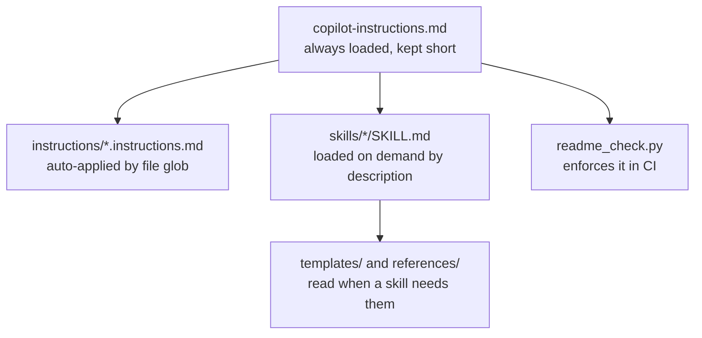

# Guide to this repo

What every file is, why it exists, and when it gets used. Read this if you have just
cloned Groundwork and want to know what you are looking at, or if you are explaining it to
someone else.

## The idea in one paragraph

AI coding agents write good code and then describe how to run it from memory. The README
ends up documenting a `requirements.txt` that was never created, or a `python app.py` when
the file is `main.py`. Nobody notices until a stranger clones the repo and gives up.
Groundwork is a set of instructions, procedures and templates that push an agent towards
finishing the job properly, plus a checker that fails the build when it did not. **The
README is treated as a build artefact with a pass or fail, not as prose.**

## Markdown does four different jobs here

Most of the files in this repo are markdown, but they are not all the same kind of thing.
The difference is **when the agent reads them**, and that is the single most useful thing
to understand.

| Kind | Where | When it loads | Cost |
|---|---|---|---|
| Always-on instructions | `.github/copilot-instructions.md`, `AGENTS.md`, `CLAUDE.md` | Every single request | Paid on every message, so it stays short |
| Scoped instructions | `.github/instructions/*.instructions.md` | Automatically, when a file matching its `applyTo` glob is touched | Only when relevant files are in play |
| Skills | `.github/skills/*/SKILL.md` | On demand, when the agent judges the description matches the task | Only when the task matches |
| Prompts | `.github/prompts/*.prompt.md` | Only when you type the slash command | Only when you ask |
| Agents | `.github/agents/*.agent.md` | Only when you pick that agent in the chat dropdown | Only when you ask |



**Why the split matters.** Everything in the always-loaded file competes for attention with
your actual question. A 400 line instructions file is not four times as effective as a 100
line one, it is less effective, because the model has to weigh all of it against every
request. So the always-on file holds only the rules that apply to everything, and the long
procedures sit in skills that get pulled in when they are relevant.

## Root files

| File | What it is | When you touch it |
|---|---|---|
| [README.md](../README.md) | The repo's own README. Also a worked example: it passes its own checker. | Replace it when you adapt this template for a real project. |
| [AGENTS.md](../AGENTS.md) | The same pointer as `copilot-instructions.md`, for agents that do not read Copilot's file (Cursor, Claude Code, Codex and friends). It is deliberately a short redirect, not a copy, so the two cannot drift apart. It also tells those tools that the prompt and agent files are readable procedures. | Rarely. |
| [CLAUDE.md](../CLAUDE.md) | Two `@` imports, `AGENTS.md` and `copilot-instructions.md`. Claude Code reads `CLAUDE.md` and only falls back to `AGENTS.md` when no `CLAUDE.md` exists, so without this it would see neither. | Never. |
| [TASKS.md](../TASKS.md) | The working task list, split into Now, Next, Deferred and Done. Carries **the reasoning**, not just checkboxes, because the reason a task exists is the part that gets lost. Anything discovered and deferred lands here in the same turn, with why. | Constantly, while building. |
| [LICENSE](../LICENSE) | MIT. | Never. |
| [ruff.toml](../ruff.toml) | Python lint and format settings, at 100 columns. | When lint rules change. |
| `.editorconfig` | Whitespace and line ending rules the editor applies regardless of who is typing. | Rarely. |
| `.gitignore` | Keeps `.venv/`, caches, build output and `.env` out of git. | Every time a build step creates a new kind of file. |

**A trap worth knowing:** ruff is configured in `ruff.toml` rather than `pyproject.toml` on
purpose. A `pyproject.toml` at the root would make `readme_check.py` classify Groundwork
itself as a Python project, and then fail its own README for not having a venv in the
Quickstart.

## `.github/`: everything that steers the agent

### The always-on file

[.github/copilot-instructions.md](../.github/copilot-instructions.md) is loaded into every
Copilot request in this workspace. It holds:

- **The one rule that matters.** A project is not finished until a stranger can clone it
  and run it from the README alone.
- **The definition of done**, as six numbered checks.
- **How to build it**: skeleton first, nothing nobody asked for, extract on the third copy,
  fail loudly, delete what you made dead, long names for parameters, the human owns the
  architecture, review against the checklist. The sources, IBM practice from the 1970s
  among them, are in [ADR 0002](decisions/0002-engineering-heuristics.md).
- **The layout table**, so the agent knows where things go.
- **The writing style rules**, including the no em dashes rule.
- **"Conventions that bite"**, a list of specific traps: always a `.venv` in the project
  root, activate commands differ per shell, notebooks need a registered kernel, never
  invent a filename in a command, pin what you install.

That last section is the highest value part of the file, because it is the only place that
records what has already gone wrong here. **Add to it every time you hit a new trap.**

### `instructions/`: rules that switch on by file type

Each file has an `applyTo` glob in its frontmatter and is injected automatically when the
agent works on a matching file. You never invoke these.

```yaml
---
applyTo: "**/*.py"
---
```

| File | Applies to | What it enforces |
|---|---|---|
| [markdown.instructions.md](../.github/instructions/markdown.instructions.md) | `**/*.md` | No em dashes, no invisible characters, one `#` heading, a language on every fenced block, no `$` prompt prefixes, wrap at 92 characters. |
| [python.instructions.md](../.github/instructions/python.instructions.md) | `**/*.py` | Target the installed version, venv conventions, pinning. |
| [notebooks.instructions.md](../.github/instructions/notebooks.instructions.md) | `**/*.ipynb` | Never commit outputs, register a kernel. |
| [shell.instructions.md](../.github/instructions/shell.instructions.md) | `**/*.sh` | `set -euo pipefail`, check with `bash -n` before running. |
| [webui.instructions.md](../.github/instructions/webui.instructions.md) | `**/*.{ts,tsx,js,jsx,vue,svelte,astro,html,css}` | Tailwind is the styling layer. **This file explicitly overrides the vendored frontend skill**, which otherwise drifts towards Material or Carbon. |

That override is the pattern to copy: you never edit a vendored skill, you add an
instruction file that wins.

### `prompts/`: the slash commands

Typed by you in Copilot Chat. Each is a short script that tells the agent which skill to
load and what the non-negotiables are. The `${input:...}` syntax prompts you for the
missing argument.

| Command | What it does |
|---|---|
| `/new-project` | Classifies the request, picks the smallest stack that fits, scaffolds, sets up the environment, runs it, writes and verifies the README. |
| `/write-spec` | Turns a vague idea into `docs/spec.md` before any code exists. |
| `/new-infra` | Scaffolds `infra/` in Bicep or Terraform, records which and why, gates on build, lint and what-if. |
| `/update-readme` | Re-derives the README from the code, runs every documented command, reports what had drifted. |

The usual order is `/write-spec`, then `/new-project`, then `/update-readme` whenever the
setup story changes.

### `skills/`: the long procedures

A skill is a folder with a `SKILL.md` whose frontmatter carries a `name` and a
`description`. The agent reads the descriptions and loads the body only when the
description matches what you asked for, so the detail is available without being expensive.

```yaml
---
name: readme-writer
description: Use when creating or updating a README, or whenever a change affects how a
  project is installed, configured, run, tested or deployed.
---
```

**Write the description for a matcher, not for a human.** It is the only part the agent
sees before deciding whether to load the rest, so it should list the situations and the
words someone would actually use.

Four skills are native to this repo:

| Skill | Load it when | What it owns |
|---|---|---|
| [project-bootstrap](../.github/skills/project-bootstrap/SKILL.md) | Starting anything new | Stack choice and scaffolding, with a reference file per track in `references/`: `python-script`, `python-cli`, `python-web`, `notebook`, `static-site`, `azure`. |
| [readme-writer](../.github/skills/readme-writer/SKILL.md) | Writing a README, or the setup story changed | The README contract and the rule that documented commands must be run first. |
| [spec-first](../.github/skills/spec-first/SKILL.md) | The request is vague or spans more than one sitting | What goes in a spec, and when not to bother writing one. |
| [iac-templating](../.github/skills/iac-templating/SKILL.md) | Writing or reviewing Bicep or Terraform | The `infra/` layout, Azure Verified Module reuse, and the build, lint, what-if gate. References in `references/bicep.md` and `references/terraform.md`. |

The `references/` subfolders are the second tier: a skill stays short and points at a
reference for the track actually in use, so building a static site never loads the Azure
material.

### Vendored skills

Two skills come from other people's repositories, pinned to a commit in
[.github/skills/vendored.json](../.github/skills/vendored.json) and fetched by
`scripts/vendor_skills.py`.

| Skill | Upstream | Notes |
|---|---|---|
| `design-taste-frontend` | `Leonxlnx/taste-skill` | Landing pages and redesigns that do not look templated. Roughly 87 KB, so it costs real context when it loads. |
| `swiftui-expert-skill` | `AvdLee/SwiftUI-Agent-Skill` | Covers the iOS 26 and 27 APIs. 10 KB entry point with 32 on-demand files under `references/`, so it is cheap. |

Each directory carries a `PROVENANCE.md` saying where it came from and a `LICENSE.upstream`
with the original copyright notice. **Both are required, not courtesy:** MIT, BSD and
Apache all oblige you to carry the notice with a substantial copy.

**Never edit a vendored directory by hand.** The next refresh overwrites it. To change how
one behaves, add an instruction file, which wins.

```bash
python3 scripts/vendor_skills.py --check    # are the files still at the pinned commit
python3 scripts/vendor_skills.py            # refetch
```

### `agents/`: alternative personalities

[.github/agents/shipwright.agent.md](../.github/agents/shipwright.agent.md) defines an
agent you select from the chat dropdown. Its frontmatter declares both a description and
the exact tool set it is allowed to use:

```yaml
tools: ['edit', 'search', 'runCommands', 'runTasks', 'problems', 'changes', 'todos', 'fetch']
```

Shipwright builds a project end to end and refuses to report it as done until the README
has been verified by running every command in it. Use it when you want the discipline
enforced by the agent rather than remembered by you.

### `workflows/checks.yml` and the PR template

[.github/workflows/checks.yml](../.github/workflows/checks.yml) runs on push to `main`, on
pull requests, and on manual dispatch. Two jobs: **README contract**, which checks every
`README.md` in the repo except the templates and then runs `--text-only` over every markdown
file except the vendored skills, and **Python**, which runs ruff (pinned to `0.16.4`) and
pytest when there is anything to run.

The README job counts the files it found and **fails if the count is zero**, because a
green check that inspected nothing is worse than no check at all.

[.github/PULL_REQUEST_TEMPLATE.md](../.github/PULL_REQUEST_TEMPLATE.md) puts the same
contract in front of a human reviewer: did the README change, did you run what you
documented, does the checker pass, are new dependencies pinned.

## `docs/`

| Path | What it is |
|---|---|
| [docs/spec.md](spec.md) | What is being built and why. Currently a placeholder that explains itself. Replace it using `templates/spec.template.md` or the `/write-spec` command. |
| [docs/decisions/](decisions/) | Numbered architecture decision records. [0001](decisions/0001-record-decisions.md) is the one that establishes the practice. [0002](decisions/0002-engineering-heuristics.md) records where the "How to build it" rules came from. |
| [docs/review-checklist.md](review-checklist.md) | Questions to put to a diff before calling it done, in the style of a Fagan inspection: real defect types only, a reader who is not the author, and a line added whenever a defect slips through. |
| [docs/demo-infra.md](demo-infra.md) | A walkthrough script for demonstrating the infrastructure workflow. |
| This file | The guide you are reading. |

**Why ADRs.** Choices made while building get forgotten and then re-made differently, or
reversed by accident by someone who assumed there was no reason behind them. Chat history
is not a record: it is unsearchable, it is not in the repo, and it does not survive the
tool that produced it. An ADR is four short sections, Context, Decision, Consequences,
Status, and it takes two minutes.

The two sections of a spec that carry the weight are **success criteria someone else can
check** ("ranks 10,000 rows in under 5 minutes", not "fast and reliable") and **non-goals**,
which is the section that stops scope growing and the one most often left out.

## `templates/`

Copy-paste sources. The agent reads these, fills in real values, and writes the result into
the project. They are excluded from CI checking because they are supposed to be full of
placeholders.

| File | What it is |
|---|---|
| [README.template.md](../templates/README.template.md) | The section order every README follows. The checker enforces the same order. |
| [spec.template.md](../templates/spec.template.md) | Problem, who it is for, success criteria, non-goals, rejected alternatives. |
| [env.example](../templates/env.example) | Copy to `.env.example` when the project reads environment variables. |
| `quickstart/python-venv.md` | Venv setup, macOS and Linux first, then Windows PowerShell. Both, always. |
| `quickstart/notebook.md` | Includes the `ipykernel install` step, without which the reader opens the notebook and finds no interpreter. |
| `quickstart/node-web.md` | Node and npm projects. |
| `quickstart/static-site.md` | Plain HTML and CSS. |
| `quickstart/docker.md` | Goes **alongside** a native quickstart, never instead of one. |
| `quickstart/azure-webapp.md` | Goes in `## Deployment`, after the local quickstart. Local first, always. |
| `quickstart/iac.md` | The infrastructure block: prerequisites, check, preview, apply, tear down. |

Each quickstart file ends with a "notes for whoever fills this in" section explaining the
traps specific to that stack. Those notes are for the author and get deleted on the way
into the README.

## `scripts/`

Durable tools only. Throwaway code gets run inline through a heredoc rather than left
behind as a file nobody will ever delete.

| Script | What it does |
|---|---|
| [readme_check.py](../scripts/readme_check.py) | The checker. Standard library only, so it runs before any environment exists. |
| [bootstrap.sh](../scripts/bootstrap.sh) | Creates `.venv`, installs, and prints the commands the README should show. |
| [vendor_skills.py](../scripts/vendor_skills.py) | Refetches the vendored skills at their pinned commits. Standard library only. Validates archive member paths so an extract cannot escape the destination. |

### What the checker actually checks

```bash
python3 scripts/readme_check.py                     # ./README.md
python3 scripts/readme_check.py apps/*/README.md    # several at once
```

Exit code 0 for pass, 1 for fail. It reports:

- **Required sections present and in order:** Requirements, Quickstart, Usage, Project
  layout, Configuration, Development.
- **Unfilled placeholders**, `<like this>` and `{{like this}}`. It uses a whitelist of real
  HTML tags rather than a loose pattern, because a loose pattern reads `<Project name>` as
  markup and lets the placeholder through, which is the exact failure the script exists to
  prevent.
- **Leftovers:** TODO, FIXME, TBD, "coming soon", lorem ipsum.
- **Quickstart commands that point at files which do not exist.** A README documenting
  `pip install -r requirements.txt` against a missing file is worse than no README, because
  the reader blames themselves.
- **Notebook projects with no kernel registration step.**
- **Em dashes.**
- **Invisible Unicode:** zero width spaces, non-breaking spaces, soft hyphens, bidi
  controls, Unicode tag characters. These arrive from web paste and turn a copied command
  into "command not found" with nothing visible to blame.

Success is one line per file: `ok   README.md`. Failure lists the specific problem and line
number.

The last two rules apply to every file, not only READMEs, so they have a mode of their own:

```bash
python3 scripts/readme_check.py --text-only           # every .md except vendored skills
python3 scripts/readme_check.py --text-only AGENTS.md # or named files
```

With no file arguments it finds every markdown file itself and skips `.venv/`,
`node_modules/` and the vendored skill directories listed in `.github/skills/vendored.json`.
Vendored skills are skipped because they follow their upstream's style, and the frontend
one uses em dashes.

**If you change the contract, change three files together** or the checker and the docs
drift apart: `scripts/readme_check.py`, `templates/README.template.md`, and the contract
table in `.github/skills/readme-writer/SKILL.md`.

## `.vscode/`

| File | What it does |
|---|---|
| `extensions.json` | Recommends Python, Pylance, Ruff, Jupyter, Copilot, markdownlint, EditorConfig on first open. |
| `settings.json` | Points the interpreter at `${workspaceFolder}/.venv/bin/python`, enables prompt files, sets the ruler and markdown wrap to 92, formats Python with ruff on save. |
| `tasks.json` | Two tasks: **Check README** (the default test task, so it runs on the test shortcut) and **Bootstrap environment**. |

## How to actually use it

### Starting something new

```bash
gh repo create my-project --template omega1119/groundwork --private --clone
cd my-project && code .
```

Then in Copilot Chat, in this order:

1. `/write-spec <the idea>` if the work is bigger than one file. Read what it writes and
   argue with it. Changing a paragraph is cheap, changing a built thing is not.
2. `/new-project <the idea>`. The agent picks a track, scaffolds, creates the environment,
   runs it, and writes the README from the template.
3. `python3 scripts/readme_check.py`. Expect `ok   README.md`.

### While working

- Deferred something? Put it in `TASKS.md` **with the reason**, in the same turn.
- Made a choice someone might reverse? Write an ADR in `docs/decisions/`.
- Changed how the project is installed or run? `/update-readme` in the same turn, not
  later.

### Adapting the template for a real project

1. Rewrite `.github/copilot-instructions.md` for the project. Keep the writing style,
   definition of done and "How to build it" sections, replace everything else, keep it
   short.
2. Replace `README.md` using `templates/README.template.md`.
3. Write `docs/spec.md`, or note in one line why the project does not need one.
4. Delete the `project-bootstrap/references/` tracks that do not apply, and delete
   vendored skills you will never use. A SwiftUI skill in a Python repo is dead weight in
   the matcher.
5. Add project-specific traps to "conventions that bite" as you hit them.

If `copilot-instructions.md` still says "Groundwork" and the repo has real code in it, the
template was cloned and never adapted. That is the signal to stop and do step 1.

## Checking your own changes

```bash
python3 scripts/readme_check.py               # the README contract
python3 scripts/readme_check.py --text-only   # em dashes, hidden characters, all .md
bash -n scripts/bootstrap.sh                  # syntax check the shell script
python3 scripts/vendor_skills.py --check      # vendored skills match their pinned commits
```

Lint and format with the version CI pins, so a new ruff release cannot turn someone else's
publish into a red build on a commit that changed nothing:

```bash
python3 -m venv .venv
.venv/bin/python -m pip install ruff==0.16.4
.venv/bin/ruff check .
.venv/bin/ruff format --check .
```
