# Spec: <project name>

**Status:** <Draft / Agreed / Building / Built>
**Last updated:** <YYYY-MM-DD>

## Problem

<What is wrong or missing today, from the point of view of whoever has the problem. Do not
name a solution here. If you cannot write this without naming the tool you want to build,
the problem is not understood yet.>

## Who it is for

<The user, and what they can be assumed to know. "A musician who has never opened a
terminal" and "a data engineer" produce very different builds.>

## Success criteria

<Checkable statements. Someone else must be able to decide whether each one is met.>

1. <e.g. Processes a 10,000 row export in under 5 minutes on a laptop.>
2. <e.g. A first-time user gets a result from a fresh clone in under 10 minutes.>
3. <e.g. No personal data leaves the machine.>

## Non-goals

<What this deliberately does not do, and briefly why. This section is what stops the scope
growing. Leaving it empty is a choice you will regret.>

- <e.g. No user accounts. Single-user, run locally.>
- <e.g. No real-time updates. A manual re-run is acceptable.>

## Constraints

| Constraint | Detail |
|---|---|
| Budget | <e.g. free tiers only> |
| Data | <e.g. contains real names, must not be committed> |
| Rate limits | <e.g. 200 API calls per hour> |
| Deadline | <date, or none> |
| Must not change | <existing thing that has to keep working> |

## Approach

```mermaid
flowchart LR
  A[<input>] --> B[<processing>] --> C[<output>]
```

<The chosen shape, in a few sentences. Stack, where it runs, how data moves through it.>

### Rejected alternatives

| Option | Why not |
|---|---|
| <option> | <reason, specific enough to stop it being re-proposed> |

## Data

<Where the input comes from, whether it is in the repo, how to get it if not, what is
sensitive, and how long anything is kept. Delete if there is no data.>

## Open questions

| Question | Blocks | Owner |
|---|---|---|
| <question> | <what it blocks> | <who answers> |

## Assumptions

<Decisions taken without asking. Each one is something the reader might disagree with, so
list them plainly rather than burying them.>

- <assumption>

## Out of scope for v1, revisit later

- <thing, and the trigger that would make it worth doing>
